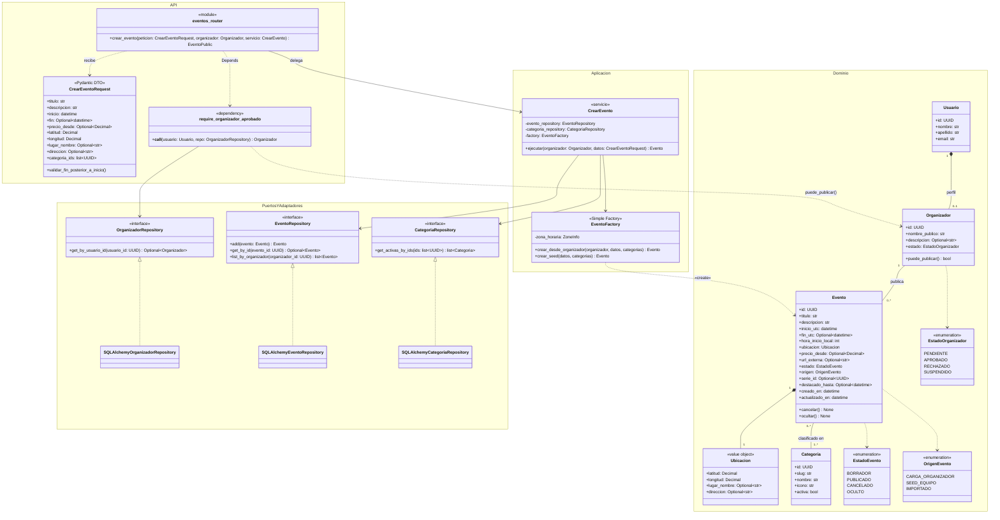

# Diagrama de clases — Creación de un evento

Relaciones entre las clases que intervienen cuando un organizador publica un evento (CU-03):
el router recibe el DTO validado por Pydantic, la dependencia `require_organizador_aprobado`
verifica que el usuario tenga un perfil de organizador `APROBADO`, y el servicio `CrearEvento`
resuelve las categorías y delega en `EventoFactory` la construcción del `Evento`, que se
persiste a través de un puerto (`EventoRepository`).

## Trazabilidad con los requisitos

| Requisito | Cómo aparece en el modelo |
|---|---|
| RF-01.7 / CU-04: solo un organizador `APROBADO` crea eventos | `Organizador.estado` + `puede_publicar()`; la dependencia `require_organizador_aprobado` corta antes del servicio |
| RF-02.1: título, descripción, inicio, fin opcional, precio opcional | Atributos de `Evento`; `fin_utc` y `precio_desde` son opcionales |
| RF-02.2: coordenadas como dato autoritativo | Value object `Ubicacion` (latitud/longitud obligatorias, dirección descriptiva) |
| RF-02.3 / RF-04.1 / RF-04.2: una o varias categorías de un catálogo cerrado | Asociación `Evento "0..*" -- "1..*" Categoria` |
| CU-03 paso 8 / 8a: validar y guardar como `PUBLICADO` | Validación en `CrearEventoRequest` y `CrearEvento`; el estado inicial lo fija `EventoFactory` |
| RF-05.2 / RF-06.1: eventos de seed e importados | `OrigenEvento` + un método de `EventoFactory` por origen |
| RNF-01.2 / RNF-08.1: UTC y filtro horario indexable | `inicio_utc` y `hora_inicio_local`, calculada al crear |
| RNF-02.3: campos preparados para fase 2 | `serie_id`, `destacado_hasta`, `OrigenEvento.IMPORTADO` |
| RNF-04.3: identificadores no secuenciales | `id: UUID` en `Evento` |

## Cómo leer el diagrama

**1. Llamado al endpoint (`eventos_router`).** El endpoint recibe un `CrearEventoRequest` ya
validado por Pydantic y declara dos dependencias: el `Organizador` (resuelto por
`require_organizador_aprobado`) y el servicio `CrearEvento` (armado en el composition root).
El router no construye entidades ni consulta la base: solo delega.

**2. El permiso se resuelve antes del servicio.** `require_organizador_aprobado` recibe el
usuario autenticado, busca su perfil en `OrganizadorRepository` y lanza 403 si no existe o si
`puede_publicar()` es falso (estado distinto de `APROBADO`). La condición de organizador se
consulta en la base y no viaja como claim del JWT, porque cambia al aprobarse o suspenderse el
perfil (ver `planning.md` §3). Así `CrearEvento` recibe un `Organizador` ya habilitado y no
mezcla autorización con la lógica de alta.

**3. Validaciones en dos niveles.**
- **Formato y coherencia interna** en el DTO: tipos, campos obligatorios, rangos de
  latitud/longitud y `validar_fin_posterior_a_inicio()`. Si fallan, FastAPI responde 422
  (CU-03, flujo alternativo 8a).
- **Reglas que necesitan la base** en `CrearEvento`: `CategoriaRepository.get_activas_by_ids`
  debe devolver todas las categorías pedidas; si falta alguna o está inactiva, el servicio
  lanza un error de dominio.

**4. `EventoFactory` (Simple Factory).** Cumple el mismo papel que `CredentialsFactory` en el
módulo de auth: centraliza lo que no viene en el DTO. Genera el UUID, convierte `inicio` y `fin`
a UTC, calcula `hora_inicio_local` con la zona horaria configurada (RNF-01.2), fija
`estado = PUBLICADO` y asigna el `origen` según el método:
- `crear_desde_organizador` → `CARGA_ORGANIZADOR`, asociado al organizador.
- `crear_seed` → `SEED_EQUIPO`, para el contenido cargado por el equipo (RF-05.2).

Sumar la ingesta de fase 2 es agregar `crear_importado`, sin tocar `Evento` ni el servicio
(OCP).

**5. `Ubicacion` es un value object compuesto, no una entidad `Lugar`.** Respeta la decisión
del MVP: dirección y coordenadas viven denormalizadas en la tabla de `Evento`, de modo que la
búsqueda por viewport no necesita joins. Modelarla como clase propia deja preparado el paso a
una entidad `Lugar` reutilizable en fase 2 (RF-02.8): la relación pasaría de composición a
asociación.

**6. `Categoria` es una asociación N:M simple.** No es agregación ni composición, porque las
categorías existen independientemente de los eventos (catálogo cerrado). `EventoCategoria` es
solo la tabla intermedia de persistencia y por eso no se dibuja como clase. La multiplicidad
`1..*` del lado de `Categoria` expresa que todo evento tiene al menos una.

**7. El servicio depende solo de puertos (DIP).** Igual que las estrategias de auth,
`CrearEvento` conoce `EventoRepository` y `CategoriaRepository` (definidos como
`typing.Protocol`), nunca las implementaciones SQLAlchemy, que se arman en `dependencies.py`.

**8. Campos preparados para fase 2.** `serie_id` (recurrencia), `destacado_hasta` (publicidad)
y `OrigenEvento.IMPORTADO` (ETL) aparecen como atributos opcionales, sin clases propias, para
evitar migraciones estructurales posteriores (RNF-02.3).

### Fuera del diagrama a propósito

- La edición y cancelación (RF-02.4) y la moderación (RF-05.1) aparecen solo como métodos de
  `Evento` (`cancelar`, `ocultar`); sus flujos se modelan aparte.
- Un evento de dominio `EventoPublicado`, con observers como en `AuthEventPublisher`, sería la
  extensión natural para notificaciones (RF-03.14, *Could have*). No entra en el MVP.
