# Diagrama de clases — Creación de un evento

Relaciones entre las clases que intervienen cuando un organizador publica un evento (CU-03):
el router recibe el DTO validado por Pydantic, la dependencia `require_organizador_aprobado`
verifica que el usuario tenga un perfil de organizador `APROBADO`, y el servicio `CrearEvento`
resuelve las categorías y delega en `EventoFactory` la construcción del `Evento`, que se
persiste a través de un puerto (`EventoRepository`).

## Estado de implementación

| Parte | Estado |
|---|---|
| Dominio (`Evento`, `Lugar`, `Categoria`, enums) y migración `0004_eventos` | ✅ Fase 0 (`app/eventos/models.py`, `app/categorias/models.py`) |
| `CategoriaRepository` y `GET /categorias` | ✅ Fase 0 (`app/categorias/`) |
| `EventoRepository.buscar` y `GET /eventos` (sin filtros todavía) | ✅ Fase 0 (`app/eventos/`) |
| `EventoFactory` con `crear_seed`, `EventoRepository.add`, `get_by_id` y `list_by_organizador` | ✅ Persona B (`app/eventos/factory.py`, `app/eventos/repository.py`) |
| `require_organizador_aprobado` | ✅ Persona B (`app/organizadores/dependencies.py`), adelantada porque la necesitan mis eventos, editar y cancelar |
| Seed de eventos (`backend/scripts/seed.py`), `GET /eventos/mios`, `PATCH /eventos/{id_evento}`, `POST /eventos/{id_evento}/cancelar` y `POST /admin/eventos/{id_evento}/ocultar` | ✅ Persona B (RF-05.2, RF-02.5, RF-02.4, RF-05.1) |
| `CrearEventoRequest`, `CrearEvento`, `EventoFactory.crear_desde_organizador`, `POST /eventos` | ⏳ Persona A (RF-02.1 a RF-02.3) |

```mermaid
classDiagram
    direction TB

    %% ───────────── Capa HTTP ─────────────
    namespace API {
        class eventos_router {
            <<module>>
            +crear_evento(peticion: CrearEventoRequest, organizador: Organizador, servicio: CrearEvento) EventoPublic
        }
        class CrearEventoRequest {
            <<Pydantic DTO>>
            +titulo: str
            +descripcion: str
            +fecha_inicio: datetime
            +fecha_fin: Optional~datetime~
            +precio: Optional~Decimal~
            +latitud: float
            +longitud: float
            +lugar_nombre: Optional~str~
            +direccion: Optional~str~
            +categorias: list~str~
            +validar_fin_posterior_a_inicio()
        }
        class require_organizador_aprobado {
            <<dependency>>
            +__call__(usuario: Usuario, repo: OrganizadorRepository) Organizador
        }
    }

    %% ───────────── Aplicación ─────────────
    namespace Aplicacion {
        class CrearEvento {
            <<servicio>>
            -evento_repository: EventoRepository
            -categoria_repository: CategoriaRepository
            -factory: EventoFactory
            +ejecutar(organizador: Organizador, datos: CrearEventoRequest) Evento
        }
        class EventoFactory {
            <<Simple Factory>>
            -zona: ZoneInfo
            -reloj: Callable
            +crear_desde_organizador(organizador, datos, categorias) Evento
            +crear_seed(titulo, descripcion, fecha_inicio, fecha_fin, lugar, categorias, precio) Evento
        }
    }

    %% ───────────── Dominio ─────────────
    namespace Dominio {
        class Usuario {
            +id: UUID
            +nombre: str
            +apellido: str
            +email: str
        }
        class Organizador {
            +id_organizador: UUID
            +nombre_publico: str
            +descripcion: str
            +estado: EstadoOrganizador
            +puede_publicar() bool
        }
        class Evento {
            +id_evento: UUID
            +id_organizador: Optional~UUID~
            +titulo: str
            +descripcion: str
            +fecha_inicio: datetime
            +fecha_fin: Optional~datetime~
            +hora_inicio_local: time
            +precio: Optional~Decimal~
            +estado: EstadoEvento
            +origen: OrigenEvento
            +fecha_publicacion: Optional~datetime~
            +fecha_actualizacion: datetime
            +programar(fecha_inicio, fecha_fin, zona) None
            +cancelar() None
            +ocultar() None
        }
        class Lugar {
            +id_lugar: UUID
            +nombre: Optional~str~
            +direccion: Optional~str~
            +latitud: float
            +longitud: float
        }
        class Categoria {
            +id_categoria: int
            +slug: str
            +nombre: str
            +descripcion: Optional~str~
            +activa: bool
        }
        class EstadoOrganizador {
            <<enumeration>>
            PENDIENTE
            APROBADO
            RECHAZADO
            SUSPENDIDO
        }
        class EstadoEvento {
            <<enumeration>>
            BORRADOR
            PUBLICADO
            CANCELADO
            OCULTO
        }
        class OrigenEvento {
            <<enumeration>>
            CARGA_ORGANIZADOR
            SEED_EQUIPO
        }
    }

    %% ───────────── Puertos (Protocols) y adaptadores ─────────────
    namespace PuertosYAdaptadores {
        class EventoRepository {
            <<interface>>
            +buscar(filtros: BusquedaEventosParams, ahora: datetime) tuple~list~Evento~, int~
            +add(evento: Evento) Evento
            +get_by_id(id_evento: UUID) Optional~Evento~
            +list_by_organizador(id_organizador: UUID) list~Evento~
        }
        class CategoriaRepository {
            <<interface>>
            +list_activas() list~Categoria~
            +get_activas_by_slugs(slugs: list~str~) list~Categoria~
        }
        class OrganizadorRepository {
            <<interface>>
            +get_by_usuario_id(usuario_id: UUID) Optional~Organizador~
        }
        class SQLAlchemyEventoRepository
        class SQLAlchemyCategoriaRepository
        class SQLAlchemyOrganizadorRepository
    }

    %% ── Llamado al endpoint ──
    eventos_router ..> CrearEventoRequest : recibe
    eventos_router ..> require_organizador_aprobado : Depends
    eventos_router --> CrearEvento : delega
    require_organizador_aprobado --> OrganizadorRepository
    require_organizador_aprobado ..> Organizador : puede_publicar()

    %% ── Creación del evento ──
    CrearEvento --> EventoRepository
    CrearEvento --> CategoriaRepository
    CrearEvento --> EventoFactory
    EventoFactory ..> Evento : «create»
    EventoFactory ..> Lugar : «create»

    %% ── Dominio ──
    Usuario "1" *-- "0..1" Organizador : perfil
    Organizador "0..1" -- "0..*" Evento : publica
    Evento "0..*" --> "1" Lugar : ocurre en
    Evento "0..*" -- "1..*" Categoria : clasificado en
    Organizador ..> EstadoOrganizador
    Evento ..> EstadoEvento
    Evento ..> OrigenEvento

    %% ── Adaptadores ──
    EventoRepository <|.. SQLAlchemyEventoRepository
    CategoriaRepository <|.. SQLAlchemyCategoriaRepository
    OrganizadorRepository <|.. SQLAlchemyOrganizadorRepository
```

## Trazabilidad con los requisitos

| Requisito | Cómo aparece en el modelo |
|---|---|
| RF-01.7 / CU-04: solo un organizador `APROBADO` crea eventos | `Organizador.estado` + `puede_publicar()`; la dependencia `require_organizador_aprobado` corta antes del servicio |
| RF-02.1: título, descripción, inicio, fin opcional, precio opcional | Atributos de `Evento`; `fecha_fin` y `precio` son opcionales |
| RF-02.2: coordenadas como dato autoritativo | Entidad `Lugar` (latitud/longitud obligatorias; nombre y dirección descriptivos) |
| RF-02.3 / RF-04.1 / RF-04.2: una o varias categorías de un catálogo cerrado | Asociación `Evento "0..*" -- "1..*" Categoria`; el catálogo lo carga la migración `0004` y se referencia por `slug` |
| RF-02.4 / RF-05.1: cancelar y ocultar | `Evento.cancelar()` (desde `BORRADOR` o `PUBLICADO`) y `Evento.ocultar()` (desde `PUBLICADO` o `CANCELADO`) |
| CU-03 paso 8 / 8a: validar y guardar como `PUBLICADO` | Validación en `CrearEventoRequest` y `CrearEvento`; el estado inicial y `fecha_publicacion` los fija `EventoFactory` |
| RF-03.3 a RF-03.6: búsqueda con filtros | `EventoRepository.buscar` aplica la regla de visibilidad y un filtro por archivo en `app/eventos/filtros/` |
| RF-04.3: retirar una categoría sin borrarla | `Categoria.activa` |
| RF-05.2: eventos de seed | `OrigenEvento.SEED_EQUIPO` + `id_organizador` nulo + `EventoFactory.crear_seed` |
| RNF-01.2 / RNF-08.1: UTC y filtro horario indexable | `fecha_inicio` en UTC y `hora_inicio_local`, calculada por `programar()` con `Settings.zona_horaria` |
| RNF-04.3: identificadores no secuenciales | UUID en `Evento` y `Lugar` |

## Cómo leer el diagrama

**1. Llamado al endpoint (`eventos_router`).** El endpoint recibe un `CrearEventoRequest` ya
validado por Pydantic y declara dos dependencias: el `Organizador` (resuelto por
`require_organizador_aprobado`) y el servicio `CrearEvento` (armado en el composition root).
El router no construye entidades ni consulta la base: solo delega.

**2. El permiso se resuelve antes del servicio.** `require_organizador_aprobado` recibe el
usuario autenticado, busca su perfil en `OrganizadorRepository` y lanza 403 si no existe o si
`puede_publicar()` es falso (estado distinto de `APROBADO`). La condición de organizador se
consulta en la base y no viaja como claim del JWT, porque cambia al aprobarse o suspenderse el
perfil (ver `planning.md` §3). Así `CrearEvento` recibe un `Organizador` ya habilitado y no
mezcla autorización con la lógica de alta.

**3. Validaciones en dos niveles.**
- **Formato y coherencia interna** en el DTO: tipos, campos obligatorios, rangos de
  latitud/longitud y `validar_fin_posterior_a_inicio()`. Si fallan, FastAPI responde 422
  (CU-03, flujo alternativo 8a).
- **Reglas que necesitan la base** en `CrearEvento`: `CategoriaRepository.get_activas_by_slugs`
  debe devolver todas las categorías pedidas; si falta alguna o está inactiva, el servicio
  lanza un error de dominio.

**4. `EventoFactory` (Simple Factory).** Cumple el mismo papel que `CredentialsFactory` en el
módulo de auth: centraliza lo que no viene en el DTO. Crea el `Lugar` a partir de las
coordenadas, asigna las fechas con `Evento.programar()` (que calcula `hora_inicio_local` con la
zona horaria configurada, RNF-01.2), fija `estado = PUBLICADO` y `fecha_publicacion`, y asigna
el `origen` según el método:
- `crear_desde_organizador` → `CARGA_ORGANIZADOR`, asociado al organizador.
- `crear_seed` → `SEED_EQUIPO`, sin organizador, para el contenido cargado por el equipo
  (RF-05.2).

Sumar un nuevo origen (por ejemplo, la ingesta de RF-06.1) es agregar un valor a
`OrigenEvento` y un método a la factory, sin tocar `Evento` ni el servicio (OCP).

**5. `Lugar` es una entidad propia, como en el DER.** El evento referencia su lugar por
`id_lugar`. En el MVP cada alta crea su propio lugar y la tabla no tiene dueño; reutilizar
lugares de eventos anteriores (RF-02.8, *Should have*) queda para fase 2 y no requiere cambiar
el esquema. La búsqueda por viewport hace un join con `lugar`, que tiene un índice sobre
`(latitud, longitud)`.

**6. `hora_inicio_local` es un dato derivado.** Las fechas se guardan como timestamps con zona
(en UTC). La hora local de inicio se guarda aparte para que el filtro horario (RF-03.5) sea una
comparación simple, sin convertir zonas horarias dentro de la query. Para que nunca quede
desincronizada, las fechas se asignan siempre con `programar()`.

**7. `Categoria` es una asociación N:M simple.** No es agregación ni composición, porque las
categorías existen independientemente de los eventos (catálogo cerrado). `evento_categoria` es
solo la tabla intermedia de persistencia y por eso no se dibuja como clase. La multiplicidad
`1..*` del lado de `Categoria` expresa que todo evento tiene al menos una. Hacia afuera, las
categorías se identifican por `slug` (`?categorias=aire-libre`), no por su id entero.

**8. El servicio depende solo de puertos (DIP).** Igual que las estrategias de auth,
`CrearEvento` conoce `EventoRepository` y `CategoriaRepository` (definidos como
`typing.Protocol`), nunca las implementaciones SQLAlchemy, que se arman en `dependencies.py`.

**9. Regla de visibilidad de la búsqueda.** `EventoRepository.buscar` solo devuelve eventos
`PUBLICADO` que no terminaron: uno con `fecha_fin` se muestra hasta que termina, y uno sin
`fecha_fin`, hasta que empieza. Por eso un evento cancelado, oculto o en borrador nunca aparece
en la búsqueda. La respuesta está paginada (`items`, `total`, `limit`, `offset`).

### Fuera del diagrama a propósito

- Los flujos de edición y cancelación (RF-02.4) y de moderación (RF-05.1) aparecen solo como
  métodos de `Evento` (`cancelar`, `ocultar`); sus servicios y endpoints se modelan aparte.
- Un evento de dominio `EventoPublicado`, con observers como en `AuthEventPublisher`, sería la
  extensión natural para notificaciones (RF-03.14, *Could have*). No entra en el MVP.
