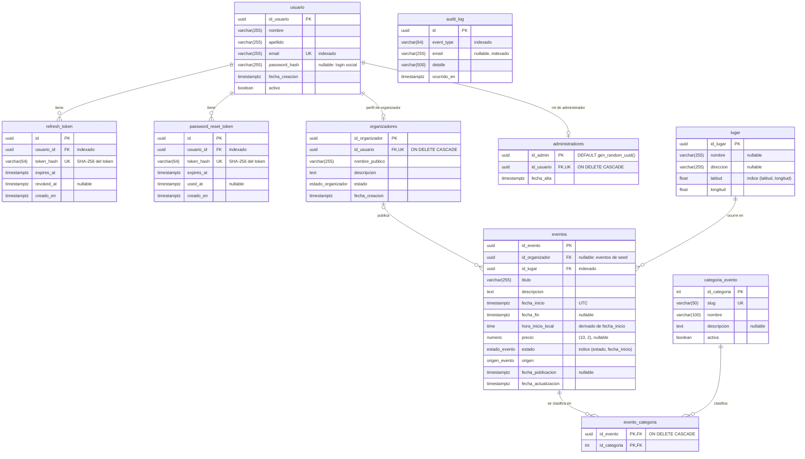
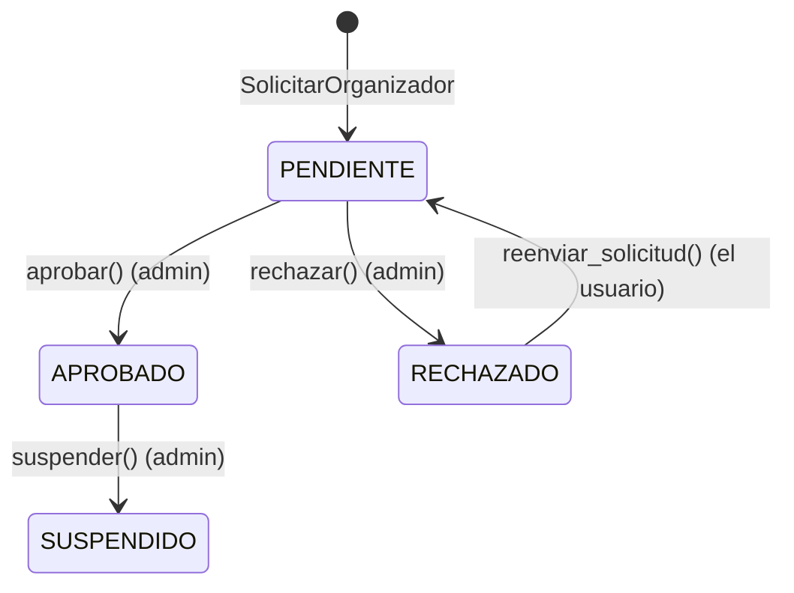
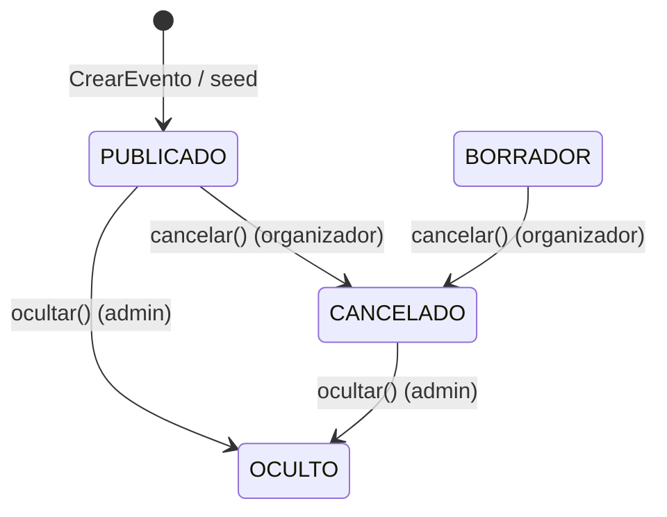

# Modelo de datos

Esquema relacional de la base (PostgreSQL), tal como lo dejan las migraciones `0001_auth_tables`
a `0005_administradores_id_default`. Las tablas y columnas salen de los modelos SQLAlchemy de
`backend/app/**/models.py`.

## Diagrama entidad-relación

`audit_log` no tiene claves foráneas: guarda el email como texto, así que también puede registrar
intentos de login con emails que no existen. Es infraestructura de seguridad (RNF-04), no parte
del dominio, y la escribe `AuditLogObserver`.

## Tipos enumerados

| Tipo (PostgreSQL) | Valores | Usado en |
|---|---|---|
| `estado_organizador` | `PENDIENTE`, `APROBADO`, `RECHAZADO`, `SUSPENDIDO` | `organizadores.estado` |
| `estado_evento` | `BORRADOR`, `PUBLICADO`, `CANCELADO`, `OCULTO` | `eventos.estado` |
| `origen_evento` | `CARGA_ORGANIZADOR`, `SEED_EQUIPO` | `eventos.origen` |

## Máquinas de estado

Las transiciones se validan en los métodos de las entidades (`Organizador.aprobar()`,
`Evento.ocultar()`, etc.). Una transición inválida lanza `TransicionEstadoInvalidaError` o
`TransicionEstadoEventoInvalidaError`, y la API responde `409`.

### Perfil de organizador

Un usuario `SUSPENDIDO` no puede volver a solicitar el perfil. Uno `RECHAZADO` reutiliza la misma
fila, porque `id_usuario` es único (multiplicidad 0..1).

### Evento

`BORRADOR` está en el enum y en las reglas de edición y visibilidad, pero hoy ningún flujo crea
eventos en ese estado: el alta los deja `PUBLICADO`.

## Decisiones del modelo

| Decisión | Motivo |
|---|---|
| PK UUID en todas las tablas salvo `categoria_evento` | Identificadores no secuenciales (RNF-04.3): no se pueden enumerar recursos. La API identifica las categorías por `slug`, así que su PK entera no se expone |
| `usuario` sin columna de rol | Los roles son tablas aparte con relación 0..1 (`organizadores`, `administradores`). Una misma cuenta busca y publica, y el permiso de administrador se consulta en cada request |
| Administradores dados de alta a mano en la base | No hay endpoint para asignar el rol: nadie puede escalar privilegios desde la app. La migración `0005` agrega `DEFAULT gen_random_uuid()` a `id_admin` para que alcance con un `INSERT ... SELECT` |
| Tokens guardados como hash | Si se filtra la base, los refresh y reset tokens no sirven. `revoked_at` y `used_at` permiten invalidarlos sin borrarlos |
| `password_hash` nullable | Deja preparado el login social (RF-01.5), donde no hay contraseña local |
| Coordenadas obligatorias, nombre y dirección opcionales en `lugar` | El pin del mapa es el dato autoritativo (RF-02.2) |
| Fechas en UTC más `hora_inicio_local` | El filtro por rango horario (RF-03.5) compara una columna `time` sin convertir zonas dentro de la query. `Evento.programar()` la recalcula siempre junto con las fechas |
| `eventos.id_organizador` nullable con `origen` | Los eventos del seed del equipo (RF-05.2) no tienen organizador y se distinguen por `origen = SEED_EQUIPO` |
| Índices `(latitud, longitud)` y `(estado, fecha_inicio)` | Cubren la búsqueda por viewport y la regla de visibilidad (solo `PUBLICADO` que no terminaron) |
| Categorías con `activa` en lugar de borrarlas | El catálogo es cerrado (RF-04.1): una categoría se retira sin romper los eventos que la usan |

## Migraciones

| Migración | Contenido |
|---|---|
| `0001_auth_tables` | `usuario`, `refresh_token`, `password_reset_token`, `audit_log` |
| `0002_organizadores` | `organizadores` y el tipo `estado_organizador` |
| `0003_administradores` | `administradores` |
| `0004_eventos` | `lugar`, `eventos`, `categoria_evento`, `evento_categoria`, los tipos `estado_evento` y `origen_evento`, y la carga de las 11 categorías |
| `0005_administradores_id_default` | `DEFAULT gen_random_uuid()` en `administradores.id_admin` (solo en PostgreSQL) |
