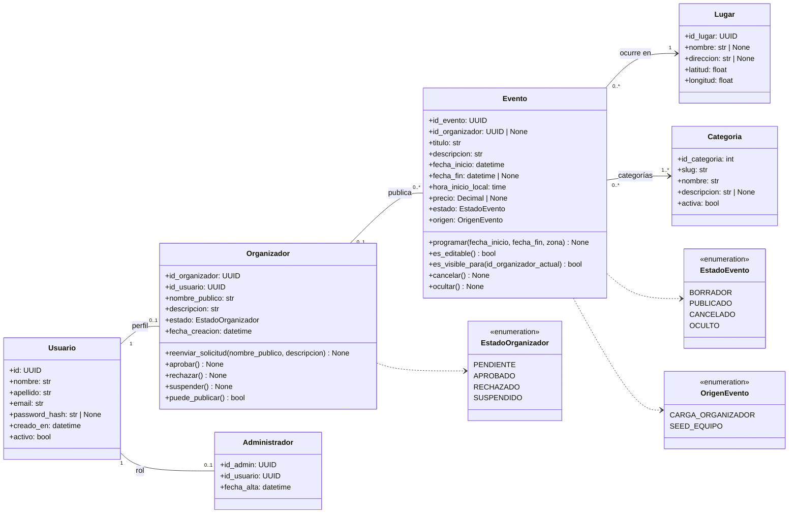
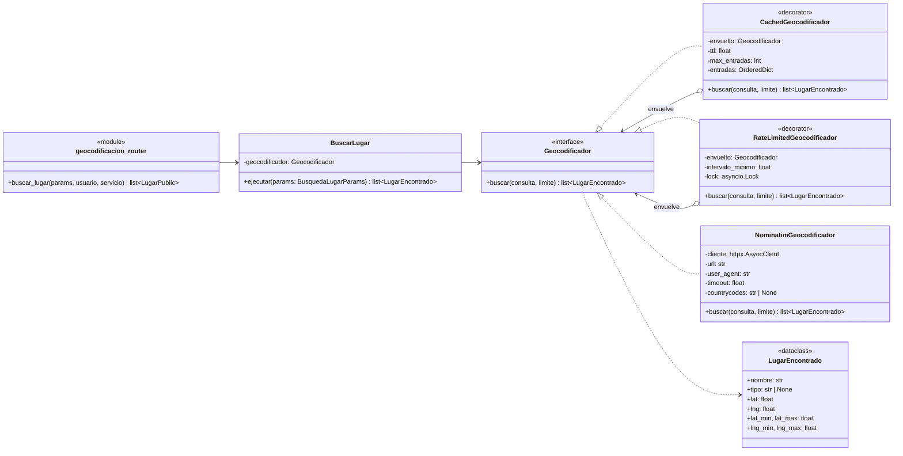

# Diagramas de clases — Organizadores, eventos y geocodificación

Este documento completa los diagramas de `05-diagrama-de-clases-auth.md` (autenticación) y
`06-diagrama-de-clases-eventos.md` (alta de un evento). Cubre las entidades del dominio, la
gestión de organizadores y administradores, la búsqueda y la gestión de eventos, y la
geocodificación. El esquema de la base está en `09-modelo-de-datos.md`.

Todos los módulos siguen la misma estructura:

- **`router`**: recibe DTOs Pydantic y traduce las excepciones del dominio a códigos HTTP con
  `error_handlers.py`.
- **`service`**: un caso de uso por clase, con un único método `ejecutar()`.
- **`repository`**: un puerto (`Protocol`) más su implementación con SQLAlchemy.
- **`dependencies.py`**: el composition root. Es el único módulo que conoce las clases concretas
  y arma cada caso de uso con `Depends`.

---

## 1. Entidades del dominio

Las entidades son los modelos SQLAlchemy. Además de los datos, tienen las reglas que dependen
solo de su propio estado: las transiciones y la visibilidad.

- `Usuario` no tiene rol: ser organizador o administrador es tener una fila en la tabla
  correspondiente.
- `Evento.programar()` es la única forma de asignar las fechas, porque recalcula
  `hora_inicio_local` en la zona configurada.
- `es_visible_para()` decide quién ve la ficha: un `OCULTO` no lo ve nadie y un `BORRADOR` solo su
  organizador.
- Las transiciones inválidas lanzan `TransicionEstadoInvalidaError` (organizador) o
  `TransicionEstadoEventoInvalidaError` (evento). Las máquinas de estado están en
  `09-modelo-de-datos.md`.

---

## 2. Organizadores y administradores

Cubre CU-04 (solicitar perfil de organizador) y RF-05.5 (aprobar, rechazar y suspender perfiles).

```mermaid
classDiagram
    direction TB

    namespace API {
        class organizadores_router {
            <<module>>
            +solicitar_organizador(datos, usuario, servicio) OrganizadorPublic
        }
        class admin_organizadores_router {
            <<module>>
            +listar_organizadores(estado, admin, servicio) list~OrganizadorPublic~
            +aprobar_organizador(id_organizador, admin, servicio) OrganizadorPublic
            +rechazar_organizador(id_organizador, admin, servicio) OrganizadorPublic
            +suspender_organizador(id_organizador, admin, servicio) OrganizadorPublic
        }
    }

    namespace Guardas {
        class get_usuario_actual {
            <<dependency>>
            401 sin sesión válida
        }
        class get_admin_actual {
            <<dependency>>
            403 si no es administrador
        }
        class require_organizador_aprobado {
            <<dependency>>
            403 si el perfil no está APROBADO
        }
    }

    namespace CasosDeUso {
        class SolicitarOrganizador {
            -repo: OrganizadorRepository
            +ejecutar(usuario, datos) Organizador
        }
        class ListarSolicitudesOrganizador {
            -repo: OrganizadorRepository
            +ejecutar(estado) list~Organizador~
        }
        class AprobarOrganizador {
            -repo: OrganizadorRepository
            +ejecutar(id_organizador) Organizador
        }
        class RechazarOrganizador {
            -repo: OrganizadorRepository
            +ejecutar(id_organizador) Organizador
        }
        class SuspenderOrganizador {
            -repo: OrganizadorRepository
            +ejecutar(id_organizador) Organizador
        }
    }

    namespace Persistencia {
        class OrganizadorRepository {
            <<interface>>
            +get_by_usuario_id(usuario_id) Organizador | None
            +get_by_id(id_organizador) Organizador | None
            +add(organizador) Organizador
            +list_by_estado(estado) list~Organizador~
        }
        class AdministradorRepository {
            <<interface>>
            +get_by_usuario_id(usuario_id) Administrador | None
        }
        class SQLAlchemyOrganizadorRepository
        class SQLAlchemyAdministradorRepository
    }

    organizadores_router --> SolicitarOrganizador : delega
    organizadores_router ..> get_usuario_actual : Depends
    admin_organizadores_router --> ListarSolicitudesOrganizador
    admin_organizadores_router --> AprobarOrganizador
    admin_organizadores_router --> RechazarOrganizador
    admin_organizadores_router --> SuspenderOrganizador
    admin_organizadores_router ..> get_admin_actual : Depends

    get_admin_actual ..> get_usuario_actual : se encadena
    require_organizador_aprobado ..> get_usuario_actual : se encadena
    get_admin_actual --> AdministradorRepository
    require_organizador_aprobado --> OrganizadorRepository

    SolicitarOrganizador --> OrganizadorRepository
    ListarSolicitudesOrganizador --> OrganizadorRepository
    AprobarOrganizador --> OrganizadorRepository
    RechazarOrganizador --> OrganizadorRepository
    SuspenderOrganizador --> OrganizadorRepository

    OrganizadorRepository <|.. SQLAlchemyOrganizadorRepository
    AdministradorRepository <|.. SQLAlchemyAdministradorRepository
```

**Cómo leerlo:**

- **Las guardas son dependencias de FastAPI encadenadas.** `get_admin_actual` y
  `require_organizador_aprobado` dependen de `get_usuario_actual`, así que sin sesión la respuesta
  es `401` antes de evaluar el rol. Con sesión y sin el rol, la respuesta es `403`.
- **Los casos de uso de administración solo orquestan.** Buscan el perfil (`404` si no existe) y
  llaman al método de la entidad (`aprobar()`, `rechazar()`, `suspender()`), que es la que valida
  la transición.
- **`SolicitarOrganizador` tiene tres caminos.**
  - Sin perfil, crea uno `PENDIENTE`.
  - Con un perfil `RECHAZADO`, lo reutiliza con `reenviar_solicitud()`.
  - Con un perfil `SUSPENDIDO`, lanza `OrganizadorSuspendidoError`. En cualquier otro estado
    lanza `SolicitudYaExistenteError`.
- **No hay caso de uso para dar de alta administradores.** Se agregan a mano en la base (ver el
  README).

---

## 3. Búsqueda y gestión de eventos

El alta (`CrearEvento` + `EventoFactory`) está detallada en `06-diagrama-de-clases-eventos.md`.
Acá aparece con el resto de los casos de uso del módulo.

```mermaid
classDiagram
    direction TB

    namespace API {
        class eventos_router {
            <<module>>
            +buscar_eventos(filtros) PaginaEventos
            +crear_evento(datos, organizador) EventoPublic
            +listar_mis_eventos(organizador) list~EventoPublic~
            +obtener_detalle_evento(id_evento, usuario) EventoDetallePublic
            +editar_evento(id_evento, datos, organizador) EventoPublic
            +cancelar_evento(id_evento, organizador) EventoPublic
        }
        class admin_eventos_router {
            <<module>>
            +ocultar_evento(id_evento, admin) EventoPublic
        }
        class BusquedaEventosParams {
            <<Pydantic DTO>>
            +lat_min, lat_max, lng_min, lng_max: float | None
            +desde, hasta: date | None
            +hora_desde, hora_hasta: time | None
            +categorias: list~str~
            +limit: int = 20
            +offset: int = 0
        }
    }

    namespace CasosDeUso {
        class BuscarEventos {
            -repo: EventoRepository
            -reloj: Callable
            +ejecutar(filtros) tuple[list[Evento], int]
        }
        class CrearEvento {
            -repo: EventoRepository
            -categorias: CategoriaRepository
            -factory: EventoFactory
            -reloj: Callable
            +ejecutar(organizador, datos) Evento
        }
        class ObtenerDetalleEvento {
            -eventos: EventoRepository
            -organizadores: OrganizadorRepository
            +ejecutar(usuario, id_evento) tuple[Evento, Organizador]
        }
        class ListarMisEventos {
            -repo: EventoRepository
            +ejecutar(organizador) list~Evento~
        }
        class EditarEvento {
            -repo: EventoRepository
            -categorias: CategoriaRepository
            -zona: ZoneInfo
            +ejecutar(organizador, id_evento, datos) Evento
        }
        class CancelarEvento {
            -repo: EventoRepository
            +ejecutar(organizador, id_evento) Evento
        }
        class OcultarEvento {
            -repo: EventoRepository
            +ejecutar(id_evento) Evento
        }
        class EventoFactory {
            -zona: ZoneInfo
            -reloj: Callable
            +crear_desde_organizador(...) Evento
            +crear_seed(...) Evento
        }
    }

    namespace Persistencia {
        class EventoRepository {
            <<interface>>
            +buscar(filtros, ahora) tuple[list[Evento], int]
            +add(evento) Evento
            +get_by_id(id_evento) Evento | None
            +list_by_organizador(id_organizador) list~Evento~
        }
        class CategoriaRepository {
            <<interface>>
            +list_activas() list~Categoria~
            +get_activas_by_slugs(slugs) list~Categoria~
        }
        class SQLAlchemyEventoRepository
        class filtros {
            <<module>>
            +solo_visibles(consulta, ahora) Select
            +filtrar_por_viewport(consulta, ...) Select
            +filtrar_por_fechas(consulta, ...) Select
            +filtrar_por_horario(consulta, ...) Select
            +filtrar_por_categorias(consulta, ...) Select
        }
    }

    eventos_router --> BuscarEventos
    eventos_router --> CrearEvento
    eventos_router --> ObtenerDetalleEvento
    eventos_router --> ListarMisEventos
    eventos_router --> EditarEvento
    eventos_router --> CancelarEvento
    admin_eventos_router --> OcultarEvento
    eventos_router ..> BusquedaEventosParams

    BuscarEventos --> EventoRepository
    CrearEvento --> EventoRepository
    CrearEvento --> CategoriaRepository
    CrearEvento --> EventoFactory
    ObtenerDetalleEvento --> EventoRepository
    ListarMisEventos --> EventoRepository
    EditarEvento --> EventoRepository
    EditarEvento --> CategoriaRepository
    CancelarEvento --> EventoRepository
    OcultarEvento --> EventoRepository

    EventoRepository <|.. SQLAlchemyEventoRepository
    SQLAlchemyEventoRepository ..> filtros : compone
```

**Cómo leerlo:**

- **Guardas por endpoint.**
  - `buscar_eventos` y `obtener_detalle_evento` piden sesión (`get_usuario_actual`), pero ningún
    rol.
  - Alta, edición, cancelación y "mis eventos" piden `require_organizador_aprobado`.
  - `ocultar_evento` pide `get_admin_actual`.
- **La búsqueda arma la consulta por composición.** `SQLAlchemyEventoRepository.buscar()` parte de
  un `Select`, aplica `solo_visibles()` (solo `PUBLICADO` que no terminaron) y después cada filtro
  que llega en la query. Cada filtro es una función pura `Select → Select`, así que sumar uno no
  toca a los demás. Mapa y lista usan la misma búsqueda (RF-03.2).
- **El reloj se inyecta.** `BuscarEventos`, `CrearEvento` y `EventoFactory` reciben `reloj`, así
  los tests fijan la hora actual sin parchear `datetime`.
- **La propiedad se valida en el caso de uso.** `EditarEvento` y `CancelarEvento` verifican que el
  evento sea del organizador autenticado. Si no lo es, lanzan `NoEsDuenioDelEventoError` y la API
  responde `403`. Un evento de seed no tiene organizador, así que no es de nadie.

---

## 4. Geocodificación

Búsqueda de lugares por texto (RF-03.7, CU-02) sobre Nominatim, respetando su política de uso
(RNF-05.1) y con caché local (RNF-01.4).

**Cómo leerlo:**

- **Los decoradores se componen en `dependencies._get_geocodificador()`:**
  `CachedGeocodificador(RateLimitedGeocodificador(NominatimGeocodificador(...)))`. La instancia es
  única por proceso, para que la caché y el límite de frecuencia se compartan entre requests.
- **El orden importa.** La caché va por fuera: un acierto no consume el cupo de una consulta por
  segundo.
- **`RateLimitedGeocodificador` hace esperar, no rechaza.** Con un `asyncio.Lock`, espacia las
  consultas salientes al intervalo mínimo configurado.
- **El bounding box usa los nombres del viewport de `GET /eventos`.** El frontend puede buscar
  eventos en el lugar elegido sin traducir nada.
- **`BuscarLugar` normaliza la consulta** (espacios repetidos) antes de llegar a la caché, así dos
  textos equivalentes no gastan dos requests.
- **Si Nominatim falla o tarda,** se lanza `GeocodificadorNoDisponibleError` y la API responde
  `503`, sin propagar la excepción de `httpx`.
